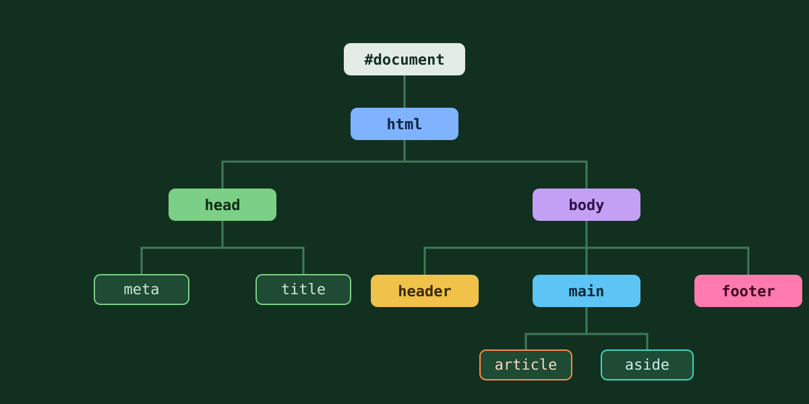

# Branch & Leaf · DOM Explorer

An interactive, responsive guide to the Document Object Model. Explore a real DOM tree node by node, test CSS selectors against it with live specificity scores, and learn how the cascade decides which rule wins.

Built with plain HTML, CSS and JavaScript. No frameworks, no build step.



## Features

### DOM tree explorer
- **Collapsible tree.** The major branches (`#document`, `html`, `head`, `body`, `header`, `main`, `article`, `footer`) open and close with a smooth animation. Expand all and Collapse all buttons are included.
- **Colour-coded branches.** Every node is coloured by the section it belongs to, with a legend.
- **Node inspector.** Select any node to see its type, depth, child count, attributes, text, a clickable path from the root and its children. Element descriptions explain what each tag is for.
- **Generated selector.** The inspector builds a short, unique `document.querySelector()` call for the selected element, shows its specificity, and can copy it.
- **Selector highlighter.** Type any CSS selector to highlight its matches in the tree. You get a match count, the selector's specificity and a "Next match" button. Invalid selectors get a clear error.
- **Editable source.** Change the sample HTML and rebuild the tree. The browser's own parser handles mistakes exactly as it would on a real page.

### CSS specificity
- How to read an A-B-C score (ID, class/attribute/pseudo-class, type/pseudo-element), compared left to right.
- Why specificity is not the same as nesting depth, shown with a paragraph seven levels deep.
- Example selectors (`p` 0-0-1, `.note` 0-1-0, `#main` 1-0-0, `#main .note p` 1-1-1 and more) that can be highlighted in the explorer.
- **Compare two selectors.** Enter any two selectors to see which column decides the winner, and whether they target the same elements.

### The cascade
A simplified decision flow: origin and importance, cascade layers, specificity, scoping proximity (`@scope`), then source order. Notes explain that `!important` changes cascade priority rather than adding to specificity, and that inline styles are a cascade step, not a fourth specificity column.

## Getting started

No install is needed. Open `index.html` in a browser.

To serve it locally instead (recommended for consistent behaviour):

```bash
# Python 3
python -m http.server 8000

# or Node.js
npx serve .
```

Then visit `http://localhost:8000`.

Fonts (Archivo and JetBrains Mono) load from Google Fonts. Offline, the page falls back to system fonts.

## Project structure

```
dom-tree/
├── index.html          Page markup: header, hero, explorer, specificity, cascade, footer
├── styles.css          Design tokens, light/dark themes, layout and components
├── app.js              Mobile menu, tree rendering, inspector, selector tools
└── images/
    └── dom-tree.svg    Hero illustration
```

## How it works

- **Real parsing.** The sample HTML lives in the `SAMPLE` constant in `app.js`. It is parsed with `DOMParser`, and the tree is rendered from the resulting document. That means highlighting uses the browser's real `querySelectorAll()`, not a simulation.
- **Specificity calculator.** A small parser in `app.js` scores selectors. It handles IDs, classes, attributes, pseudo-classes, pseudo-elements (including legacy single-colon forms), `:is()`, `:not()` and `:has()` (highest argument), `:where()` (zero), and `:nth-child(… of S)`. Selector lists report the highest score. Namespace selectors such as `svg|rect` are not handled.
- **Animation.** Branches animate with a `grid-template-rows` transition from `0fr` to `1fr`. Collapsed branches are marked `inert`, so their contents can't be focused.

## Accessibility

- Every branch toggle is a `<button>` with `aria-expanded` and `aria-controls`.
- The tree uses a roving tabindex: one Tab stop, then arrow keys inside.

| Key | Action |
| --- | --- |
| <kbd>↑</kbd> / <kbd>↓</kbd> | Move to the previous / next visible node |
| <kbd>→</kbd> | Open a branch, or move into it |
| <kbd>←</kbd> | Close a branch, or move to the parent |
| <kbd>Home</kbd> / <kbd>End</kbd> | Jump to the first / last visible node |
| <kbd>Esc</kbd> | Close the mobile menu |

- Status messages use `aria-live` regions.
- All animation is disabled when the operating system's reduced-motion setting is on.
- Visible focus outlines, a skip link and labelled landmarks are included.

## Responsive behaviour

| Width | Layout |
| --- | --- |
| Above 1000px | Tree and inspector side by side; cascade steps in one row |
| 1000px and below | Inspector moves below the tree; the tree panel scrolls on its own |
| 760px and below | Navigation collapses behind a Menu button |
| Phones | All sections stack to one column |

Light and dark themes follow the system setting.

## Customising

- **Use your own HTML.** Replace the `SAMPLE` string in `app.js`, or paste markup into the editor on the page.
- **Element descriptions.** Edit the `DESCRIPTIONS` object in `app.js`.
- **Example selectors.** Edit the `EXAMPLES` array in `app.js` and the chips in `index.html`.
- **Colours and fonts.** Change the tokens at the top of `styles.css`. Branch colours are the `--c-*` variables, with dark-mode values in the two dark-theme blocks.

## Browser support

Current versions of Chrome, Edge, Firefox and Safari. The page relies on `color-mix()`, the `inert` attribute, `:scope` and `CSS.escape()`.
